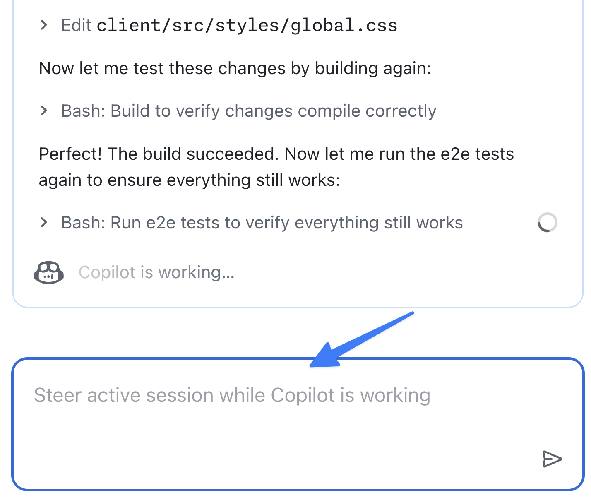

前几课中，你让 Copilot 云代理处理了三个独立任务，用于改善用户体验和添加功能。云代理虽然异步自主工作，但监控任务仍然很重要。

可以使用多种工具管理分配给云代理的任务，包括 GitHub.com 上的 [agents 页面][agents-page]。在这个 Mission Control 中，可以查看所有带有未关闭拉取请求（PR）的代理任务、查看已执行的操作，并在会话进行中提供指导。

本课将学习如何：

- 使用 agents 页面监控云代理任务。
- 在会话进行中引导代理添加功能。

## 场景

让代理创建高对比度模式后，团队决定也添加浅色模式。由于代理正在更新网站样式并添加切换功能，因此希望引导它同时实现这两种模式。

## 查看 Copilot 云代理任务

1. 打开 [Copilot agents 页面](https://github.com/copilot/agents)。
2. 查看主面板和左侧面板中的任务，其中应包括更新代码文档、生成游戏管理 API，以及为网站添加高对比度模式。
3. 选择一个正在运行的任务，查看 Copilot 已执行的操作，例如检出代码、创建工作环境、设置 MCP 服务器和完成任务的步骤。

> [!NOTE]
> 具体步骤会根据 Copilot 的工作状态和处理方式而有所不同。

4. 查看右侧显示的 PR 面板，以监控 PR 和变更文件。

## 引导云代理

现在让 Copilot 在实现高对比度模式的同时加入浅色模式。

1. 选择正在添加高对比度模式的会话。会话标题因 Copilot 采用的名称和当前工作状态而异。

    

2. 观察会话几分钟，直到代理完成设置并开始工作。
3. 在 **Steer active session while Copilot is working** 对话框中输入以下提示：

    ```plaintext
    While we are working on a high contrast mode, let's also add a light mode. There should be a switch for this mode as well where users can select their desired display mode.
    ```

    

4. 按 <kbd>Enter</kbd> 发送提示。
5. 注意 Copilot 会确认收到提示并将其纳入工作流程。

## 等待 Copilot 完成

Copilot 会处理更新后的任务，并在完成发送提示时正在执行的步骤后，将新要求加入工作流程。等待期间，可以回顾目前学到的内容。

## 总结和后续步骤

本课介绍了 Copilot agents 页面，它是监控和引导 GitHub Copilot 云代理任务的中心位置。你可以跟踪所有活动和已完成的任务、审查代理正在执行的工作，也可以调整正在进行任务的范围或提供额外指导。

你学习了如何使用 Mission Control 监控云代理任务，并引导会话添加功能。接下来[迭代 Copilot 创建的拉取请求][next-lesson]。

## 资源

- [Copilot agents 页面][agents-page]
- [关于自定义代理][custom-agents]

---

| [← 上一课：自定义代理][previous-lesson] | [下一课：迭代 Copilot 的工作 →][next-lesson] |
|:--|--:|

[previous-lesson]: ../3-custom-agents/
[next-lesson]: ../5-iterating/
[agents-page]: https://github.blog/changelog/2025-07-03-agents-page-for-copilot-coding-agent-in-public-preview
[custom-agents]: https://docs.github.com/copilot/concepts/agents/cloud-agent/about-custom-agents
